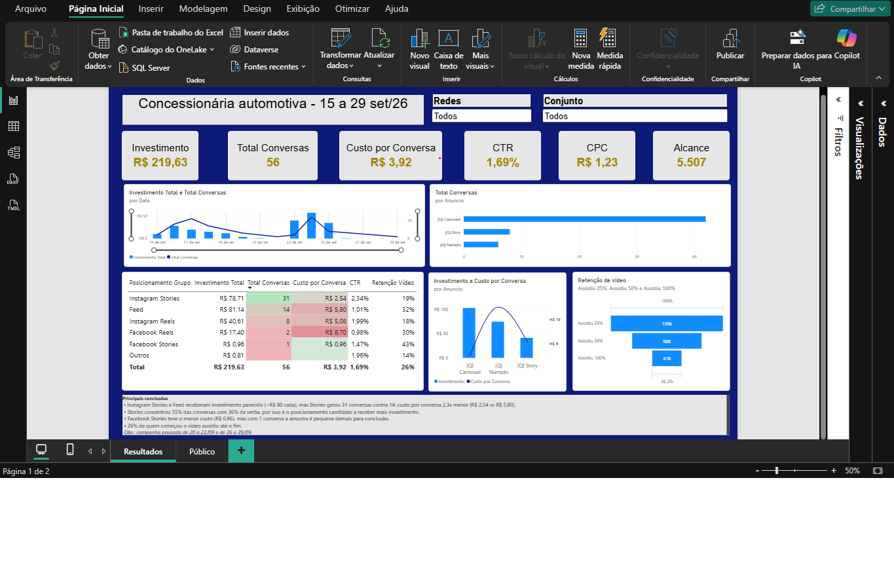

# Dashboard de Campanha Meta Ads — Concessionária Automotiva

Análise de desempenho de uma campanha de mensagens no WhatsApp (Meta Ads) para uma concessionária de veículos em Santa Catarina, construída no **Power BI** com dados reais anonimizados.



---

## Pergunta de negócio

> Com um orçamento pequeno (cerca de R$ 220 em 15 dias), **onde cada real investido gera mais conversas com potenciais compradores?**

Para responder, o dashboard compara custo por conversa entre **posicionamentos** (Stories, Feed, Reels…) e entre **anúncios** (Carrossel, Story, Narrado), além da retenção dos vídeos.

## Dados

| Item | Detalhe |
| --- | --- |
| Fonte | Exportação CSV do Gerenciador de Anúncios da Meta |
| Período | 15 a 29 de setembro de 2026 |
| Granularidade | Dia × anúncio × posicionamento |
| Resultado medido | Conversas iniciadas no WhatsApp |
| Anonimização | Nome da cliente, da concessionária, das campanhas e dos anúncios removidos. Valores mantidos. |

## Ferramentas

- **Power BI Desktop**: Power Query, DAX, visualizações
- **Meta Ads Manager**: extração dos dados

## Etapas

### 1. Tratamento no Power Query
- Ajuste de tipos de dados (datas, moeda, inteiros).
- Remoção de colunas com dados identificáveis.
- **Agrupamento de posicionamentos pequenos em "Outros":** cinco posicionamentos (Marketplace, Explorar, Reels in-stream, Resultados da pesquisa e Status) somavam R$ 0,81 sem nenhuma conversa e geravam ruído, como um CTR de 20% com quase nenhuma impressão.

```m
if List.Contains(
    {"Instagram Stories", "Feed", "Instagram Reels", "Facebook Reels", "Facebook Stories"},
    [Posicionamento]
) then [Posicionamento] else "Outros"
```

A lista guarda os posicionamentos **mantidos**. Assim, um posicionamento novo em exportações futuras cai automaticamente em "Outros".

### 2. Medidas DAX
Todos os visuais usam as mesmas medidas, para que os números sempre batam entre si.

```dax
Investimento Total = SUM(campanha[Investimento])
Total Conversas    = SUM(campanha[Conversas iniciadas])
Custo por Conversa = DIVIDE([Investimento Total], [Total Conversas])
CTR = DIVIDE([Total Cliques], [Total Impressões])
Retenção Vídeo = DIVIDE(SUM(campanha[Video 100]), SUM(campanha[Video 25]))
```

O CTR é recalculado como cliques ÷ impressões, e não pela média da coluna de CTR do CSV, porque média de percentuais distorce o resultado.

### 3. Reconciliação dos totais
Na primeira versão, os cartões do topo mostravam **R$ 219,63** e a tabela de posicionamentos somava **R$ 218,82**. A investigação mostrou que os posicionamentos sem conversas estavam fora da tabela. Depois do agrupamento em "Outros", todos os totais batem: investimento, conversas, custo por conversa e CTR.

## Resultados

| Indicador | Valor |
| --- | --- |
| Investimento | R$ 219,63 |
| Conversas no WhatsApp | 56 |
| Custo por conversa | R$ 3,92 |
| CTR | 1,69% |
| CPC | R$ 1,23 |
| Alcance | 5.507 |

| Posicionamento | Investimento | Conversas | Custo por conversa |
| --- | ---: | ---: | ---: |
| Instagram Stories | R$ 78,71 | 31 | R$ 2,54 |
| Feed | R$ 81,14 | 14 | R$ 5,80 |
| Instagram Reels | R$ 40,61 | 8 | R$ 5,08 |
| Facebook Reels | R$ 17,40 | 2 | R$ 8,70 |
| Facebook Stories | R$ 0,96 | 1 | R$ 0,96 |
| Outros | R$ 0,81 | 0 | — |
| **Total** | **R$ 219,63** | **56** | **R$ 3,92** |

## Principais conclusões

1. **Instagram Stories foi o posicionamento mais eficiente.** Com investimento parecido ao do Feed (cerca de R$ 80 cada), gerou 31 conversas contra 14. O custo por conversa foi **2,3x menor** (R$ 2,54 vs R$ 5,80).
2. **Stories concentrou 55% das conversas usando 36% da verba**, por isso é o principal candidato a receber mais investimento.
3. **O anúncio Carrossel gerou 75% das conversas** (42 de 56) e teve o menor custo por conversa entre os anúncios. O Narrado teve o maior custo.
4. **26% de quem começou o vídeo assistiu até o fim** (418 de 1.596 visualizações de 25%).
5. **Facebook Stories teve o menor custo (R$ 0,96), mas com uma única conversa.** A amostra é pequena demais para tirar conclusão.

## Recomendações

- Realocar parte da verba do Feed para Instagram Stories e acompanhar se o custo por conversa se mantém com mais investimento.
- Priorizar o formato Carrossel nos próximos criativos.
- Testar Facebook Stories com um orçamento dedicado antes de qualquer decisão.

## Limitações

- Período curto (15 dias) e orçamento baixo: as diferenças entre posicionamentos pequenos não são estatisticamente conclusivas.
- A campanha ficou pausada de 20 a 22/09 e de 26 a 29/09.
- Conversas iniciadas medem interesse, não vendas: o dashboard não inclui dados de fechamento.

## Estrutura do repositório

```
├── README.md
├── dashboard-meta-ads.pbix   # arquivo Power BI (dados anonimizados)
├── dashboard-meta-ads.pdf    # versão em PDF
└── dashboard.png
```

## Autor

**João Carlos Leonetti** · [LinkedIn](https://www.linkedin.com/in/jo%C3%A3o-leonetti-b499991bb/)
